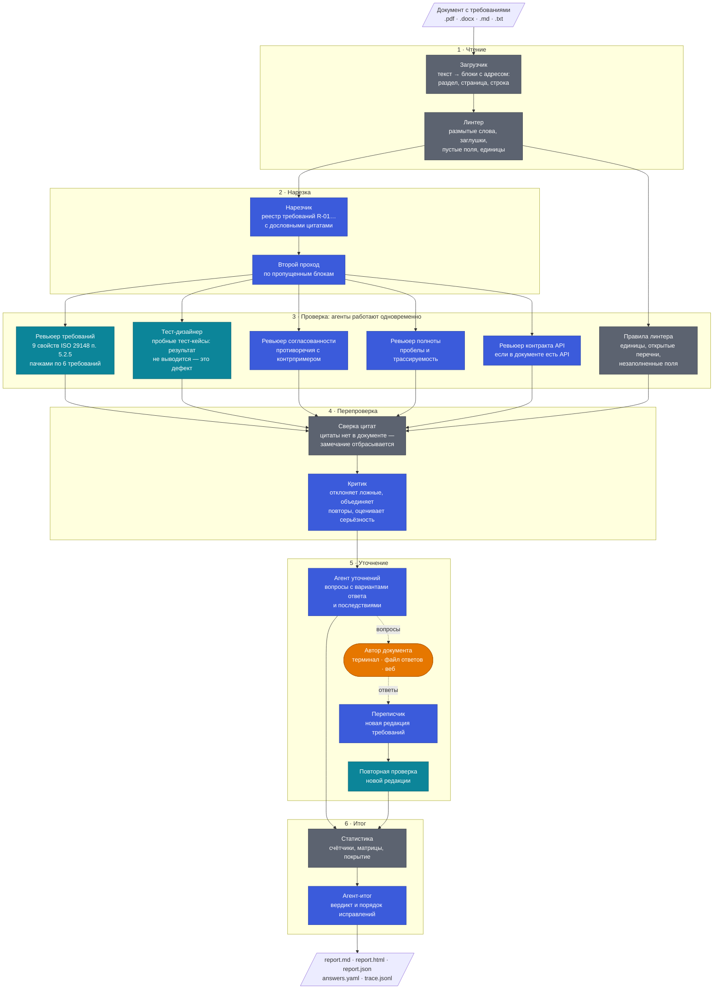

# Revizorro — ИИ-агент проверки требований

Revizorro проводит статическое ревью документа с требованиями до начала разработки. Агент выделяет отдельные требования, проверяет каждое и весь набор по ISO/IEC/IEEE 29148:2018 (п. 5.2.5, 5.2.6) и IEEE Std 830-1998 (п. 4.3) и записывает отчёт на русском. Каждое нарушение в отчёте привязано к месту в документе и дословной цитате.

**Пример результата:** [отчёт по выданному документу](examples/report.md) и [тот же отчёт после ответов на два вопроса](examples/report-answered.md) с новой редакцией требований. Файл `examples/report.json` можно перетащить в веб-интерфейс и посмотреть результат без запуска модели.

Чем Revizorro отличается от «промпта с чек-листом»:

- **Контрпример вместо мнения.** Каждое противоречие подтверждается сценарием с числами: «при таких исходных данных пункт А требует одно, пункт Б — другое». Агент-тест-дизайнер пробует написать тест-кейсы по каждому требованию. Если ожидаемый результат нельзя вывести из текста, это отдельное доказательство дефекта.
- **Вопросы-развилки.** Уточняющий вопрос приходит с адресатом, вариантами ответа и последствиями каждого варианта. После ответа агент переписывает требования и проверяет новую редакцию.
- **Проверка без галлюцинаций.** Код сверяет каждую цитату с документом: находка без подтверждённой цитаты в отчёт не попадает. Отдельный агент-критик перепроверяет все находки, отклоняет ложные и склеивает дубли. Все числа в сводке считает код, а не модель.

## Быстрый старт

Нужны Python 3.12+ и [uv](https://docs.astral.sh/uv/getting-started/installation/) (или обычный `pip`, см. ниже).

**1. Получите ключ модели.** Хватает одного из двух:

- **Gemini, бесплатно.** Откройте [aistudio.google.com/apikey](https://aistudio.google.com/apikey), войдите аккаунтом Google и нажмите «Create API key».
- **OpenAI, платно.** Создайте ключ на [platform.openai.com/api-keys](https://platform.openai.com/api-keys). Один прогон стоит от $0.06 до $1 в зависимости от модели (см. «Модели»).

**2. Положите ключ в файл `.env`** в корне репозитория:

```bash
cp .env.example .env        # Windows: copy .env.example .env
```

Откройте `.env` и впишите ключ в `GEMINI_API_KEY=` или `OPENAI_API_KEY=`. Файл `.env` в git не попадает.

**3. Запустите проверку одной командой:**

```bash
uv run --project backend revizorro examples/requirements.md reports/report.md
```

Первый аргумент — документ с требованиями (`.pdf`, `.docx`, `.md`, `.txt`), второй — путь к отчёту. В `examples/` лежит выданный организаторами документ и его PDF-версия (`requirements.pdf`, собрана скриптом `scripts/md_to_pdf.py`) для проверки чтения PDF. При первом запуске `uv` сам создаст окружение и поставит зависимости. Прогон занимает 5–10 минут.

**4. Откройте отчёт.** Файлы появятся рядом с указанным путём:

| Файл | Что внутри |
| :--- | :--- |
| `reports/report.md` | основной отчёт на русском |
| `reports/report.html` | тот же отчёт для просмотра в браузере |
| `reports/report.json` | все данные прогона: требования, находки, тест-кейсы, вопросы |
| `reports/report.answers.yaml` | шаблон для ответов на вопросы-развилки |
| `reports/report.trace.jsonl` | журнал запросов к модели и отклонённых находок |

### Без uv

Подойдёт обычный `pip` и Python 3.12+. Из корня репозитория:

```bash
pip install -r requirements.txt
python main.py --input examples/requirements.md --output reports/report.md
```

`main.py` — тонкая обёртка над той же командой `revizorro`: принимает `--input` и `--output` или два пути подряд, остальные параметры передаёт без изменений. В `requirements.txt` закреплены те же версии зависимостей, что и в `backend/uv.lock`.

## Модели

Модель выбирается в `.env` строкой `провайдер:модель`. `MODEL_DEFAULT` работает на массовых шагах (проверка каждого требования, тест-дизайн), `MODEL_STRONG` — там, где важна глубина (нарезка, проверка набора, критик, вопросы, итог). Если переменные не заданы, Revizorro при наличии ключа OpenAI берёт конфигурацию «Баланс», иначе `google:gemini-3.5-flash`.

| Конфигурация | `MODEL_DEFAULT` | `MODEL_STRONG` | Стоимость прогона |
| :--- | :--- | :--- | :--- |
| Бесплатно | `google:gemini-3.5-flash` | `google:gemini-3.5-flash` | $0 на бесплатном тарифе |
| Дёшево | `openai:gpt-6-luna` | `openai:gpt-6-luna` | около $0.06 |
| Баланс (по умолчанию при ключе OpenAI) | `openai:gpt-6-luna` | `openai:gpt-6.1-terra` | около $0.3 |
| Максимальное качество | `openai:gpt-6.1-terra` | `openai:gpt-6.1-sol` | около $1 |
| Бесплатные токены OpenAI | `openai:gpt-5.4-mini` | `openai:gpt-5.4` | около $1.5 по прайсу, $0 в пределах суточного лимита |
| Одна мини-модель | `openai:gpt-5.4-mini` | `openai:gpt-5.4-mini` | около $0.7 по прайсу |

Модель можно задать и в команде: `--model google:gemini-3.5-flash --strong-model google:gemini-3.5-flash`.

**Бесплатный Gemini.** На бесплатном тарифе у каждой модели около 20 запросов в день и лимит в минуту. Для Gemini Revizorro сам переходит в экономный режим: проверяет по 15 требований за запрос и держит не больше 2 запросов одновременно, поэтому прогон укладывается примерно в 13 запросов. Если квота модели кончилась или модель перегружена, агент переключается на следующую бесплатную модель: `gemini-3.5-flash` → `gemini-3.8-flash` → `gemini-3.7-flash` → `gemini-3.5-flash-lite` → `gemini-3.1-flash-lite`. Свою цепочку можно задать в `MODEL_FALLBACKS`. Модели, которые фактически ответили, записываются в паспорт отчёта.

**Бесплатные суточные токены OpenAI.** Организациям, которые включили обмен данными с OpenAI, часть моделей даётся бесплатно в пределах суточного лимита (счётчик обнуляется в 00:00 UTC). Один прогон выданного документа тратит около 160–180 тыс. токенов на массовых шагах и 130–140 тыс. на «сильных», поэтому удобно развести роли по разным группам лимита: `MODEL_DEFAULT=openai:gpt-5.4-mini`, `MODEL_STRONG=openai:gpt-5.4`. В отчёте стоимость всегда считается по прайсу, даже если запросы прошли бесплатно.

Для закрытого контура подойдёт локальная модель через [Ollama](https://ollama.com): `MODEL_DEFAULT=ollama:qwen3:14b`, документы не покидают машину.

**Повторный прогон бесплатный.** Ответы модели кэшируются в `.revizorro_cache/`: тот же документ с теми же моделями и промптами даёт тот же отчёт без новых запросов. Флаг `--no-cache` отключает кэш, флаг `--cache-only` запрещает обращаться к модели: если ответа в кэше нет, прогон остановится, не потратив ни токена. Для веб-интерфейса то же самое включает переменная `REVIZORRO_CACHE_ONLY=1`.

## Уточнение: ответы на вопросы-развилки

Агент составляет вопросы к авторам документа. У каждого вопроса есть адресат, варианты ответа с последствиями и рекомендуемый вариант. Ответить можно двумя способами:

```bash
# в терминале, по ходу прогона
uv run --project backend revizorro examples/requirements.md reports/report.md --interactive

# файлом: впишите буквы вариантов в reports/report.answers.yaml и запустите снова
uv run --project backend revizorro examples/requirements.md reports/report.md --answers reports/report.answers.yaml
```

После ответов агент переписывает затронутые требования и проверяет новую редакцию. В отчёте появляется раздел «Уточнения и новая редакция» в формате «было → стало» со списком закрытых замечаний. Благодаря кэшу повторный прогон с ответами тратит запросы только на переписывание. Номера вопросов относятся к конкретному прогону: отвечайте на вопросы из файла `*.answers.yaml`, который лежит рядом с отчётом, и не отключайте кэш между прогонами.

## Веб-интерфейс

Нужен [Node.js](https://nodejs.org) 20+.

```bash
cd frontend && npm install && npm run build && cd ..
uv run --project backend revizorro-api
```

Откройте <http://127.0.0.1:8000>, перетащите документ или нажмите «Проверить пример». Разделы результата:

- **Итог** — вердикт о готовности, что исправить в первую очередь, какие свойства требований нарушены и какой агент что нашёл.
- **Замечания** — список слева, документ справа. Замечание раскрывается в карточку: цитата, проблема, последствия, контрпример, способ исправить. Документ при этом прокручивается к цитате. Щелчок по отмеченному фрагменту документа показывает замечания к нему.
- **Вопросы авторам** — варианты ответа с последствиями; по ответам агент переписывает требования и проверяет новую редакцию.
- **Требования** — реестр нарезки; строка открывает карточку требования с замечаниями, пробными тест-кейсами и связанными вопросами.

Обозначения `R-07`, `F-057`, `Q-08` в любом тексте кликабельны и ведут к требованию, замечанию или вопросу. Адрес страницы указывает на открытый раздел и элемент, им можно поделиться. Те же ссылки работают в `report.html`.

Сохранённый отчёт открывается без повторной проверки: перетащите на стартовый экран файл `report.json`, который лежит рядом с отчётом.

Порт меняется переменной `REVIZORRO_PORT`. Для разработки интерфейса: `revizorro-api` в одном терминале и `npm run dev` в папке `frontend` в другом, затем <http://localhost:5173>. Интерфейс собран на React и Ant Design.

## Измеренное качество

Полнота — доля дефектов из эталонного списка, которые нашёл агент. Эталонов два:

- [eval/expected_defects.yaml](eval/expected_defects.yaml) — 37 дефектов выданного документа;
- [eval/generalization/](eval/generalization/) — второй документ из другой предметной области («Перевод по номеру телефона») с 14 заложенными дефектами. Он проверяет, что агент не заточен под один файл.

| Документ | Конфигурация | Найдено дефектов | Из них критичных | Стоимость |
| :--- | :--- | :---: | :---: | :---: |
| выданный, `.md` | Баланс | 34 из 37 (92%) | 4 из 4 | $0.33 |
| выданный, `.pdf` | Баланс | 35 из 37 (95%) | 4 из 4 | $0.26 |
| второй документ | Баланс | 13 из 14 (93%) | 3 из 3 | $0.15 |
| выданный, `.md` | `gpt-5.4-mini` + `gpt-5.4` | 28 из 37 (76%) | 4 из 4 | $1.48 по прайсу |
| выданный, `.md` | одна `gpt-5.4-mini` на все роли | 23 из 37 (62%) | 3 из 4 | $0.73 по прайсу |
| выданный, `.md` | бесплатный Gemini | 17 из 37 (46%) | 2 из 4 | $0 |

Как читать эти цифры:

- Сопоставление находок с эталоном автоматическое: по месту в документе и ключевым словам. Точность (долю верных находок) оно не измеряет — для неё скрипт создаёт `eval/labels.csv`, где человек отмечает каждую находку: верно, ложно, спорно.
- Ответы модели недетерминированы: от прогона к прогону результат меняется на 2–3 дефекта.
- Строки про PDF и Gemini измерены на более ранней версии агента. Gemini на бесплатном тарифе из-за квот отвечал в основном младшей моделью `gemini-3.1-flash-lite`, отсюда низкая полнота.
- Младшая модель на «сильных» ролях теряет треть дефектов: `gpt-5.4-mini` в одиночку не нашла противоречие на границе месяцев и ни одно замечание не оценила как критичное. Больше всего на качество влияет модель в `MODEL_STRONG`: с `gpt-5.4` в этой роли агент находит все критичные дефекты, но замечаний выходит вдвое меньше, чем в конфигурации «Баланс» (24 против 54), а прогон идёт около 18 минут.
- Конфигурация «Максимальное качество» в раннем замере нашла столько же дефектов, сколько «Баланс», при втрое большей цене.

Повторить измерение:

```bash
uv run --project backend python eval/evaluate.py reports/report.json
uv run --project backend python eval/evaluate.py reports/phone/report.json --expected eval/generalization/expected_defects.yaml
```

## Параметры командной строки

| Параметр | Что делает |
| :--- | :--- |
| `--model`, `-m` | модель для массовых шагов |
| `--strong-model` | модель для проверки набора, критика, вопросов и итога |
| `--interactive`, `-i` | задать вопросы-развилки в терминале |
| `--answers`, `-a` | YAML с ответами на вопросы |
| `--no-cache` | не использовать кэш ответов модели |
| `--cache-only` | брать ответы только из кэша: к модели не обращаться, токены не тратить |
| `--concurrency` | сколько запросов к модели идут одновременно (по умолчанию 6, для Gemini 2) |
| `--batch-size` | сколько требований проверяется за один запрос (по умолчанию 6, для Gemini 15) |
| `--env-file` | путь к `.env`, если он не в текущей папке |

## Что в отчёте

1. **Паспорт прогона**: документ, SHA-256 файла, дата, модели, версия агента (`git describe`), версия промптов, токены, стоимость.
2. **Как агент нарезал требования**: таблица «ID в отчёте — ID в документе — вид — краткая формулировка — где в документе».
3. **Проверка каждого требования**: матрица девяти свойств ISO 29148 п. 5.2.5 и карточка каждого требования с цитатой, нарушениями, контрпримерами и пробными тест-кейсами.
4. **Проверка всего набора**: свойства ISO 29148 п. 5.2.6 и IEEE 830 п. 4.3, матрица трассируемости, замечания к набору с контрпримерами.
5. **Сводка**: число требований и нарушений, разбивка по серьёзности и свойствам, список критичных дефектов.
6. **Итог**: можно ли начинать разработку и тестирование и что исправить в первую очередь.
7. **Вопросы к авторам**: вопросы-развилки по убыванию влияния.

В приложениях: как проводилась проверка, воронка находок, отклонённые критиком находки с причинами, сигналы линтера.

## Как это устроено

Одиннадцать узких агентов и пять шагов на обычном коде. Модель ищет дефекты и пишет текст, код проверяет цитаты и считает числа. На выданном документе прогон делает 26–28 запросов к модели и занимает 6–9 минут.



Цвета на схеме: синий — агент на сильной модели (`MODEL_STRONG`), бирюзовый — агент на массовой модели (`MODEL_DEFAULT`), серый — код без обращения к модели, оранжевый — человек.

Структура кода, цифры по агентам и защита от галлюцинаций — в [docs/ARCHITECTURE.md](docs/ARCHITECTURE.md).

## Разработка

```bash
cd backend
uv run pytest          # тесты не обращаются к модели и не тратят токены
uv run ruff check src tests
uv run pyright
```

Структура:

```text
backend/src/revizorro/
  ingestion/   чтение PDF, DOCX, MD, TXT в блоки с якорями
  agents/      агенты: нарезчик, ревьюеры, тест-дизайнер, критик, вопросы, итог
  prompts/     промпты агентов (русский язык), их хэш — версия промптов в паспорте
  tools/       детерминированные инструменты: сверка цитат, линтер
  llm/         фабрика моделей, кэш, повторы, учёт токенов и стоимости
  pipeline/    оркестратор и статистика
  reporting/   шаблоны и рендер отчёта
examples/      выданный организаторами документ и отчёты агента по нему
main.py           запуск без uv: python main.py --input … --output …
requirements.txt  закреплённые зависимости для pip
```

## Ограничения

- Агент оценивает текст документа. Необходимость, реализуемость и корректность часто нельзя оценить без знаний о бизнесе и платформе — такие свойства помечены в отчёте знаком «?» и превращены в вопросы, а не в выдуманные нарушения.
- Результат модели недетерминирован: два прогона без кэша дают похожие, но не идентичные отчёты. Для воспроизводимости используется кэш и фиксируется версия агента и промптов.
- Сканы PDF без текстового слоя не поддерживаются: нужен PDF с текстом.
