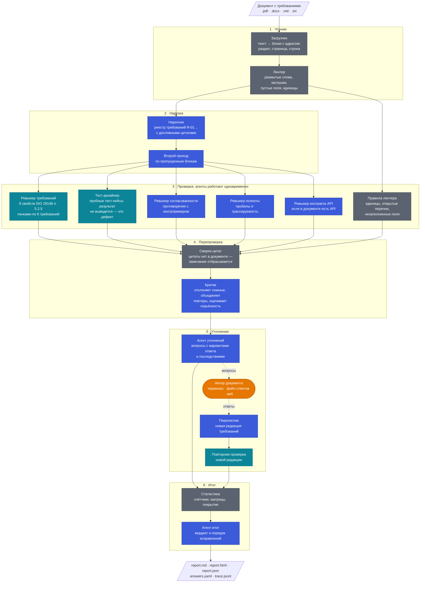
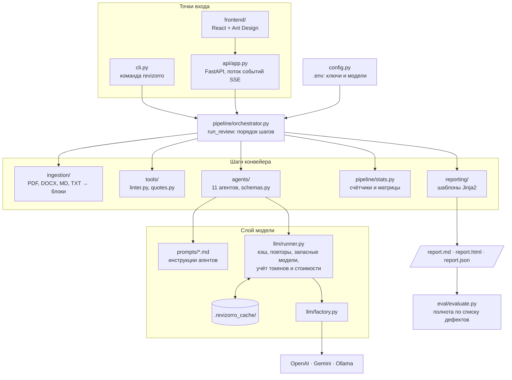

# Архитектура Revizorro

## Задача и принципы

Revizorro проверяет готовый документ с требованиями до разработки: ищет дефекты формулировок и выпускает отчёт, по которому команда решает, можно ли начинать разработку и тестирование.

Три принципа определяют архитектуру:

1. **Каждое утверждение отчёта проверяемо.** Нарушение без места в документе бесполезно, а нарушение с выдуманной цитатой вредно. Поэтому модель ссылается на блок документа и дословную цитату, а код проверяет, что цитата там действительно есть.
2. **Модель пишет текст, код считает.** Таблица нарезки, матрицы, счётчики, воронка находок и правила вердикта вычисляются программно. Сводка всегда сходится с таблицами.
3. **Узкие агенты вместо одного большого промпта.** У каждого агента одна задача, своя схема ответа и своя модель. Их результаты проверяют код и другой агент.

## Конвейер

Цвета на схеме: синий — агент на сильной модели (`MODEL_STRONG`), бирюзовый — агент на массовой модели (`MODEL_DEFAULT`), серый — код без обращения к модели, оранжевый — человек.

Проверяющие агенты зависят только от реестра требований, поэтому работают одновременно. Если в документе есть спецификация API, к ним добавляется ревьюер контракта API. Параллелизм ограничен семафором (`REVIZORRO_CONCURRENCY`), чтобы не упираться в лимиты провайдера.

## Агенты

| Агент | Вход | Выход | Модель | Зачем отдельно |
| :--- | :--- | :--- | :--- | :--- |
| Нарезчик | весь документ | реестр требований с цитатами и связями | сильная | от реестра зависят все следующие шаги. Код проверяет якоря и цитаты, а блоки, оставшиеся без классификации, уходят на второй проход: измерения показали, что дешёвая модель пропускала строки критериев приёмки |
| Ревьюер требований | документ + пачка требований + сигналы линтера | нарушения 9 свойств, «нельзя оценить» | массовая | узкий фокус на одном требовании даёт больше находок, чем проверка «всего сразу» |
| Тест-дизайнер | документ + пачка требований | 1–3 тест-кейса на требование; невыводимые — с причиной | массовая | другой взгляд: не «что не так в тексте», а «можно ли по нему тестировать»; независимо подтверждает дефекты ревьюера |
| Ревьюер согласованности | документ + реестр | противоречия с контрпримерами | сильная | противоречия видны только при сопоставлении многих мест |
| Ревьюер полноты | документ + реестр + матрица покрытия | пробелы, трассируемость, версия, приоритеты | сильная | ищет то, чего в тексте нет, — другая задача, чем проверка написанного |
| Ревьюер контракта API | документ + реестр (запускается, если в реестре от 3 требований вида «API») | расхождения метода, типов, кодов, тел ответов и заголовков | сильная | дефекты контракта разбросаны по строкам разных таблиц и теряются в общей проверке; в банковских ТЗ спецификация API — типовой раздел |
| Критик | документ + все находки | решение по каждой: оставить, отклонить, склеить | сильная | модель, которая искала дефекты, плохо оценивает собственные ложные срабатывания |
| Агент уточнений | документ + подтверждённые находки | вопросы-развилки с вариантами и последствиями | сильная | превращает дефекты в решения, которые может принять автор |
| Переписчик и повторная проверка | ответ автора + затронутые требования | новая редакция и её замечания | сильная / массовая | замыкает цикл «вопрос → ответ → исправленное требование» |
| Итог | статистика + критичные находки + вопросы | вердикт и первые исправления | сильная | формулирует решение, но числа получает от кода |

Кроме агентов, находки даёт линтер на правилах (`tools/linter.py`): одна величина в разных единицах, открытые перечни («и далее», «и т. д.»), незаполненные поля и разделы шаблона. Такие дефекты модель иногда пропускает, а правило находит всегда. Находки правил проходят того же критика, что и находки агентов.

Все агенты построены на [PydanticAI](https://ai.pydantic.dev): у каждого типизированная схема ответа (`agents/schemas.py`), невалидный ответ модель переделывает автоматически. Описания полей схемы на русском — часть промпта.

## Прогон в цифрах

Замеры сделаны на выданном документе (124 блока текста, 55–59 требований после нарезки).

| Что | Сколько |
| :--- | :--- |
| Агентов на модели | 11: нарезчик, ревьюер требований, тест-дизайнер, ревьюеры согласованности, полноты и контракта API, критик, агент уточнений, переписчик, повторная проверка, итог |
| Из них работает в обычном прогоне | 9: переписчик и повторная проверка включаются только после ответов на вопросы, ревьюер контракта API — только если в документе есть спецификация API |
| Шагов на коде без модели | 5: загрузчик, линтер с правилами, сверка цитат, статистика, рендер отчёта |
| Запросов к модели за прогон | 26–28 |
| Токенов за прогон | около 200 тыс. на входе и 110–160 тыс. на выходе |

Запросы по агентам: нарезчик — 1–2, ревьюер требований — 10 (по 6 требований в запросе), тест-дизайнер — 9–10, ревьюеры согласованности, полноты и контракта API — по одному, критик, агент уточнений и итог — по одному.

| Конфигурация | Длительность прогона |
| :--- | :--- |
| `gpt-6-luna` + `gpt-6.1-terra` | 6–9 минут: 8,6 минуты на PDF-версии, 6 минут на втором документе из 20 требований |
| `gpt-5.4-mini` + `gpt-5.4` | около 18 минут: отдельные запросы мини-модели шли по 10–12 минут |
| повторный прогон из кэша | несколько секунд |
| прогон с ответами на вопросы поверх готового | около минуты |

На что уходит время при 8–9 минутах: нарезка — около минуты, параллельная проверка — 4–5 минут (её длину задаёт самый долгий из ревьюеров набора), критик — около двух минут, вопросы — минута, итог — полминуты. Чтение документа, сверка цитат, статистика и рендер занимают доли секунды.

## Защита от галлюцинаций и шума

| Риск | Мера |
| :--- | :--- |
| Выдуманная цитата | `tools/quotes.py`: цитата нормализуется (регистр, кавычки, тире, пробелы, ё) и ищется в указанном блоке, затем во всём документе, затем нечётко в соседних блоках. Не нашлась — находка исключается со статусом `unverified` |
| Неверный якорь | цитата, найденная в другом блоке, перепривязывается к нему |
| Ложное срабатывание | агент-критик с правом отклонить находку только по конкретной причине, со ссылкой на блок |
| Дубли | критик склеивает дубли; код запрещает склеивать находки к разным требованиям, если у них нет общего блока |
| Свойство нельзя оценить по тексту | отдельная категория «нельзя оценить» и вопрос к автору вместо нарушения |
| Вердикт расходится с находками | правило в коде: при критичном нарушении вердикт не может быть «можно начинать» |
| Подгонка под один документ | в промптах нет фактов проверяемого документа; эталон дефектов используется только для измерения; качество дополнительно измеряется на втором документе из другой области |

Отклонённые и склеенные находки не исчезают: они перечислены в приложении отчёта с причинами и в журнале `*.trace.jsonl`.

## Структура кода

Обе точки входа, консоль и веб-интерфейс, вызывают одну функцию `run_review`. Агенты не обращаются к провайдеру напрямую: все запросы идут через `llm/runner.py`, где живут кэш, повторы и учёт токенов.

Типы данных и каталог критериев лежат в `domain/` (`models.py`, `criteria.py`) и используются всеми слоями. Веб-интерфейс работает только с `report.json`, поэтому умеет открыть и сохранённый отчёт.

## Модель данных

`domain/models.py`:

- `Document` → `Block` (якорь, вид, текст, раздел, строки, страница).
- `Requirement` — элемент реестра: `R-01`, ID в документе, вид, цитата, блоки, связи.
- `Finding` — нарушение: свойство из каталога, серьёзность, локации (блок + цитата + проверка), контрпример `Scenario`, источник-агент, статус после критика.
- `TestProbe`, `Question` с вариантами `QuestionOption`, `Resolution` с `Rewrite`.
- `Report` — всё вместе плюс паспорт прогона и журнал вызовов модели.

Каталог критериев (`domain/criteria.py`) — единый источник названий, ссылок на пункты стандартов и описаний нарушений для промптов и отчёта.

## Воспроизводимость и стоимость

- **Паспорт прогона**: SHA-256 входного файла, модели, `git describe` версии агента, хэш промптов, токены, стоимость.
- **Кэш ответов** (`llm/runner.py`): ключ — агент, модель, промпт, схема ответа, глубина рассуждений. Повторный прогон того же документа бесплатен и даёт тот же отчёт; прогон с ответами на вопросы тратит запросы только на переписывание.
- **Документ — в начале каждого запроса**: одинаковый префикс позволяет провайдеру кэшировать его, вход дешевле в несколько раз.
- **Повторы**: при `429`, `503`, обрыве соединения запрос повторяется с ожиданием, учитывающим `Retry-After`.
- **Запасные модели**: если у модели кончилась дневная квота или она не отвечает после трёх попыток, запрос уходит следующей модели того же провайдера (`MODEL_FALLBACKS`; для бесплатного Gemini цепочка включена по умолчанию). Кэш проверяется по всей цепочке, поэтому повторный прогон находит ответ запасной модели.
- **Экономный режим Gemini**: бесплатный тариф даёт около 20 запросов в день на модель, поэтому для Gemini требования идут пачками по 15, а параллельно выполняется не больше 2 запросов. Прогон укладывается примерно в 13 запросов.
- **Стоимость** считается по официальному прайсу OpenAI (`llm/pricing.py`).

## Расширение

- **Новый формат** — функция в `ingestion/`, приводящая файл к Markdown.
- **Новый критерий или внутренний стандарт банка** — запись в `domain/criteria.py`: он сразу попадает в промпты и матрицы отчёта.
- **Другая модель или провайдер** — строка в `.env`; для закрытого контура — `ollama:<модель>`.
- **Веб-интерфейс** — конвейер отдаёт события прогресса через callback (`on_event`), поверх него строится API с потоком событий (SSE). Клиент (React, Ant Design) работает только с JSON отчёта, поэтому умеет открыть и сохранённый `report.json` без обращения к модели.

## Как измеряется качество

`eval/expected_defects.yaml` — эталонный список дефектов выданного документа. `eval/generalization/` — второй документ из другой предметной области со своим эталоном: он проверяет, что агент не заточен под один файл. `eval/evaluate.py` считает полноту (долю найденных эталонных дефектов, в том числе по серьёзности) и ведёт `eval/labels.csv`, в котором человек отмечает каждую находку как верную, ложную или спорную. Из разметки получается точность. Метки привязаны к свойству, требованию и цитате, поэтому переживают повторные прогоны.
